## Purpose and scope

chainkit is a small, typed Python library for building USDC payment systems on Solana. It packages the parts of a
payments backend that are easy to get subtly wrong and expensive when they are wrong: representing money exactly,
recognising genuine USDC, building transfers that contain nothing unexpected, inspecting a transaction before signing
it, detecting deposits from any sender, surviving RPC provider outages, and reading a trustworthy price straight from
the Pyth oracle on Solana.

It was extracted from GT Pay, a USDC wallet and payroll platform, where it runs both the application's payment path
and its separate signing service. It is a **library**: it never stores, generates or transmits private keys, and it does
not run a server.

| Item | Value |
|---|---|
| Distribution | `pip install solana-chainkit` (import name `chainkit`) |
| Licence | Apache-2.0 |
| Python | 3.10, 3.11, 3.12, 3.13 |
| Runtime dependencies | `solders` (Solana types and signing primitives), `requests` (HTTP) |
| Size | About 430 statements across 8 modules |
| Verification | 125 unit tests (100% line and branch coverage), 14 live tests against Solana mainnet, Devnet and Pyth, strict mypy, ruff |

## Where chainkit sits

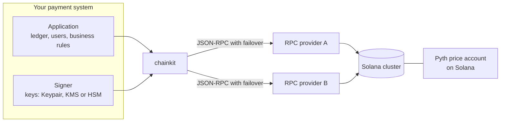

chainkit gives the application and the signer the same vocabulary: the application uses it to detect deposits, quote
costs and describe intents; the signer uses it to build the exact transaction and to check it before signing.

## Module architecture

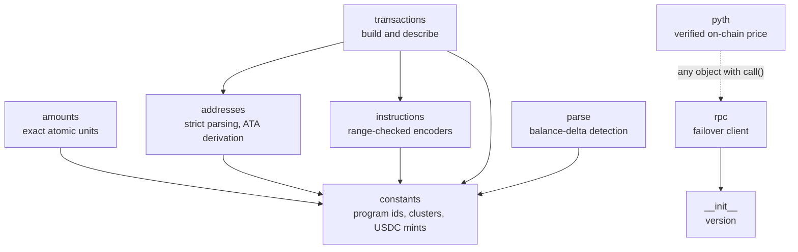

Modules import nothing at load time from the network. `pyth` depends on a structural interface (`SupportsCall`), not on
`rpc`, so any JSON-RPC client can be used.

## Data types and units

| Type | Definition |
|---|---|
| Atomic amount | `int`, USDC base units (1 USDC = 1,000,000). The only representation used for money. |
| `Json` | `dict[str, Any]`, a parsed JSON-RPC result (for example a `jsonParsed` transaction) |
| `TransferPlan` | fee payer, source owner, mint, amount, exactly one of destination owner or destination token account, memo, priority fee, compute limit, decimals |
| `MessageFacts` | fee payer, signers, programs, transfers, account creations, memos, compute limit and price, `unknown`; property `is_clean` |
| `PythPrice` | feed id, price (`Decimal`), confidence (`Decimal`), publish time, fully verified |
| `RpcError` | message, JSON-RPC `code` (or None), `transient` (True when a retry later is safe) |
| Errors | `AmountError`, `AddressError`, `PythError` (all `ValueError`), `ValueError` for out-of-range plans and encodings |

## Module specifications

### constants

| Name | Value or behaviour |
|---|---|
| `TOKEN_PROGRAM` | `TokenkegQfeZyiNwAJbNbGKPFXCWuBvf9Ss623VQ5DA` (classic SPL Token, used by USDC) |
| `TOKEN_2022_PROGRAM` | `TokenzQdBNbLqP5VEhdkAS6EPFLC1PHnBqCXEpPxuEb` (recognised so it can be rejected) |
| `ATA_PROGRAM`, `SYSTEM_PROGRAM`, `COMPUTE_BUDGET_PROGRAM`, `MEMO_PROGRAM` | Canonical program ids |
| `CLUSTERS` | mainnet-beta and devnet: genesis hash and Circle USDC mint |
| `USDC_DECIMALS`, `ATOMIC_PER_USDC` | 6 and 1,000,000 |
| `MAX_TRANSACTION_BYTES` | 1,232 (Solana packet limit) |
| `TOKEN_ACCOUNT_SIZE` | 165 bytes (rent is charged on this size) |
| `U64_MAX` | 2^64 - 1, the largest SPL token amount |
| `usdc_mint(cluster)`, `genesis_hash(cluster)` | Look-ups; `ValueError` for an unknown cluster |
| `cluster_for_genesis(hash)` | Cluster name or None |
| `ALLOWED_PROGRAMS` | The five programs a chainkit transfer may touch |

Every program id, both mints and both genesis hashes are checked against the live clusters by the live tests.

### amounts

| Function | Contract |
|---|---|
| `to_atomic(value) -> int` | Accepts a decimal string (`'150.25'`, `'1,250.50'`) or `Decimal`. Rejects floats, plain integers, booleans, scientific notation, non-ASCII digits, malformed thousands separators, zero, negatives, more than 6 decimals and values above `U64_MAX`. |
| `from_atomic(atomic) -> Decimal` | Exact, 6 decimal places; rejects non-integers |
| `format_usdc(atomic, places=2) -> str` | Display only, half-up rounding, thousands separators |

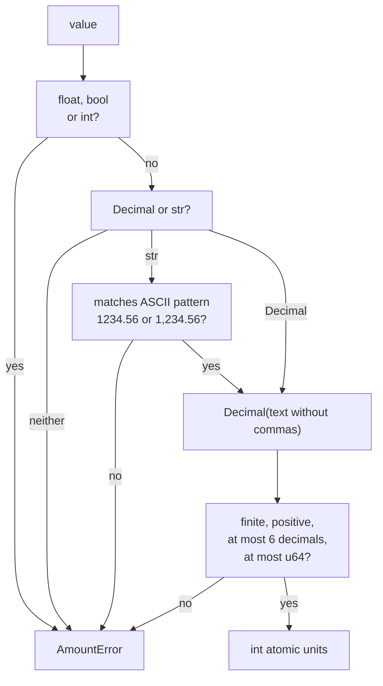

### addresses

| Function | Contract |
|---|---|
| `parse_pubkey(value) -> Pubkey` | Strict base58: trims surrounding spaces, 32 to 44 characters, must decode and round-trip exactly; anything else raises `AddressError` (including non-strings) |
| `derive_ata(owner, mint) -> Pubkey` | Associated token account under the classic token program: program-derived address of seeds owner, token program, mint |
| `is_on_curve(address) -> bool` | True for signing wallets, False for program-derived addresses such as token accounts |

### instructions

Each encoder range-checks every integer before encoding, so invalid input fails in Python instead of producing a
corrupt or surprising transaction.

| Instruction | Program | Data layout | Accounts |
|---|---|---|---|
| `transfer_checked(source, mint, destination, owner, amount, decimals)` | Token | `[12] + u64 amount LE + u8 decimals` (10 bytes) | source (w), mint, destination (w), owner (signer) |
| `create_ata_idempotent(payer, ata, owner, mint)` | Associated Token Account | `[1]` | payer (signer, w), ata (w), owner, mint, system program, token program |
| `set_compute_unit_limit(units)` | Compute Budget | `[2] + u32 LE` (1 to 1,400,000) | none |
| `set_compute_unit_price(micro_lamports)` | Compute Budget | `[3] + u64 LE` | none |
| `memo(text)` | Memo | UTF-8 bytes (1 to 120) | none |

`transferChecked` is used instead of `transfer` so the token program itself verifies the mint and decimals on-chain.

### transactions

`build_transfer_message(plan, recent_blockhash) -> Message` validates the plan, derives token accounts and assembles a
legacy message in a fixed order: compute limit, optional priority fee, optional idempotent account creation (only when
paying an owner wallet), `transferChecked`, optional memo. It refuses: no or two destinations, a non-positive or
oversized amount, invalid addresses, source equal to destination, and any transaction above 1,232 bytes.

`describe_message(message) -> MessageFacts` decodes any legacy message into plain facts and never raises on unexpected
content; it reports it.

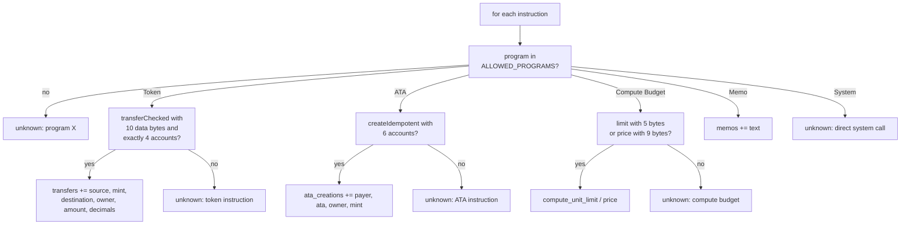

A signer accepts a message only if `facts.is_clean` and the facts equal the intent (amount, mint, destination, fee
payer, signers). Extra signer accounts, other token instructions (such as approvals or plain `transfer`), direct SOL
transfers and unknown programs all make the message unclean.

`transaction_size(message)` returns the serialized size including signatures.

### parse

Detection uses **balance deltas** (the `preTokenBalances` and `postTokenBalances` of a `jsonParsed` transaction), not
instruction parsing. A payment is therefore seen whichever program moved it: a wallet, an exchange withdrawal, an
aggregator or a smart contract.

| Function | Contract |
|---|---|
| `usdc_delta(tx, token_account, mint) -> int` | Net change of that token account for that mint; 0 for failed transactions or accounts not present; negative for outflows, including a closed account |
| `owner_delta(tx, owner, mint) -> int` | Net change across every token account of `owner` for `mint` |
| `senders(tx, mint) -> list[str]` | Owners whose balance of `mint` decreased (empty for failed transactions) |
| `fee_lamports(tx) -> int` | Network fee paid |

Rules applied to every balance row: the mint must equal the requested mint exactly, and the row's token program must be
the classic token program (a Token-2022 row with the same address is ignored). Account keys may be strings or
`jsonParsed` objects; for version-0 transactions the `jsonParsed` account list includes lookup-table addresses, so
balance indexes resolve correctly (verified by a live test).

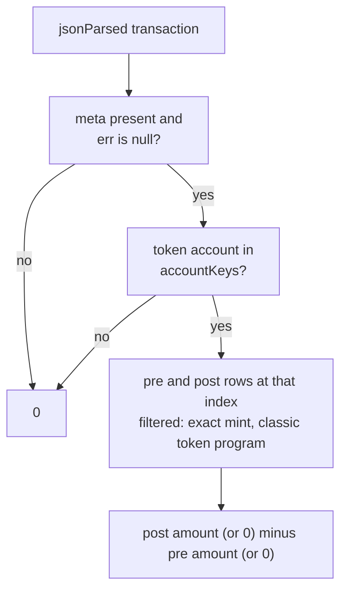

### rpc

`SolanaRpc(urls, timeout=20, session=None)` calls endpoints in order with failover.

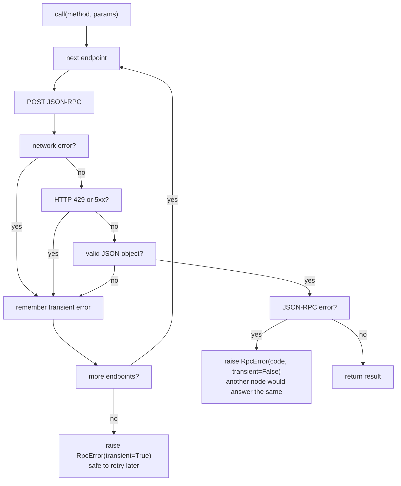

Typed helpers: `genesis_hash`, `latest_blockhash` (returns blockhash and `lastValidBlockHeight`), `block_height`,
`send_transaction` (preflight on, node-side retries off so the caller owns retry decisions), `signature_statuses`,
`transaction` (`jsonParsed`, version 0 supported), `signatures_for_address`, `all_signatures_since` (follows every
page; raises rather than returning a partial list), `account_info`, `token_balance` (0 for an account that does not exist
yet), `sol_balance`, `minimum_balance_for_rent_exemption`, `request_airdrop`. `verify_client()` returns a client pinned to
the last endpoint, for confirming critical facts with an independent provider.

### pyth

`read_price(rpc, account=SOL_USD_PRICE_ACCOUNT, feed_id=SOL_USD_FEED_ID, max_age_seconds=300, max_conf_ratio=0.02)`
reads a Pyth `PriceUpdateV2` account directly from Solana. No API key is involved.

| Offset | Size | Field |
|---|---|---|
| 0 | 8 | Anchor discriminator |
| 8 | 32 | Write authority |
| 40 | 1 or 2 | Verification level: `0` Partial (followed by a u8 signature count) or `1` Full |
| next | 32 | Feed id |
| next | 8, 8, 4, 8 | Price (i64), confidence (u64), exponent (i32), publish time (i64) |
| next | 8, 8, 8, 8 | Previous publish time, EMA price, EMA confidence, posted slot |

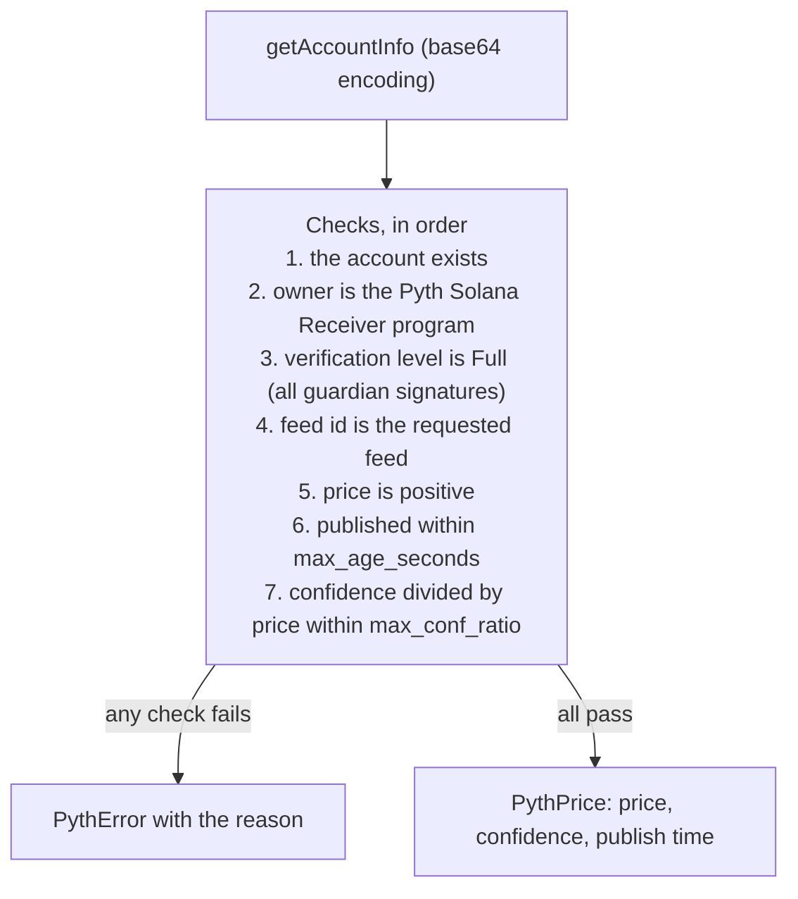

Defaults: SOL/USD feed `ef0d8b6f...b56d`, sponsored price account `7UVimffxr9ow1uXYxsr4LHAcV58mLzhmwaeKvJ1pjLiE`
(same address on mainnet and Devnet), Pyth Solana Receiver program `rec5EKMGg6MxZYaMdyBfgwp4d5rB9T1VQH5pJv5LtFJ`.

## End-to-end flows

### Detecting a deposit

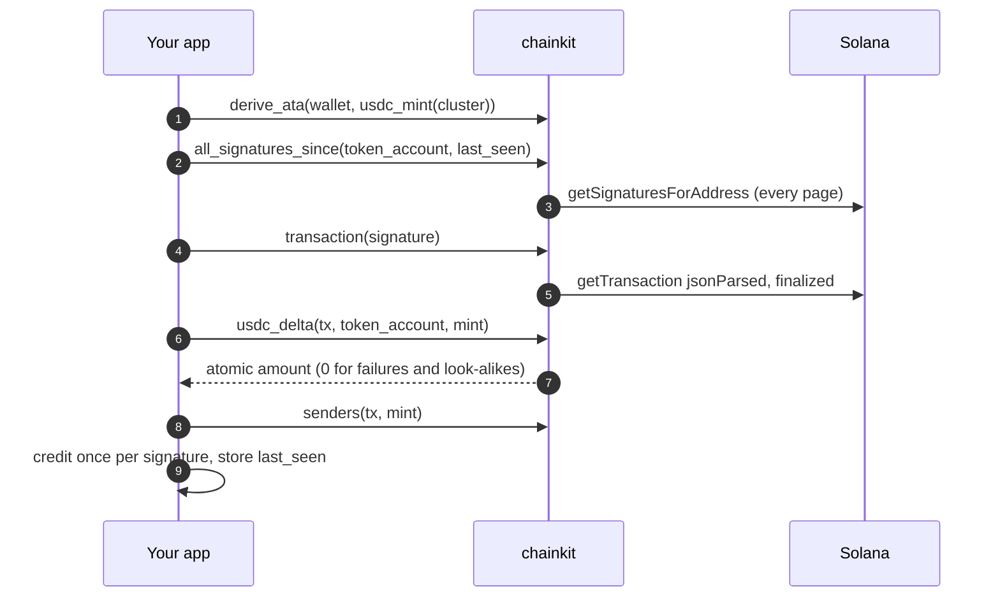

### Sending a payout safely

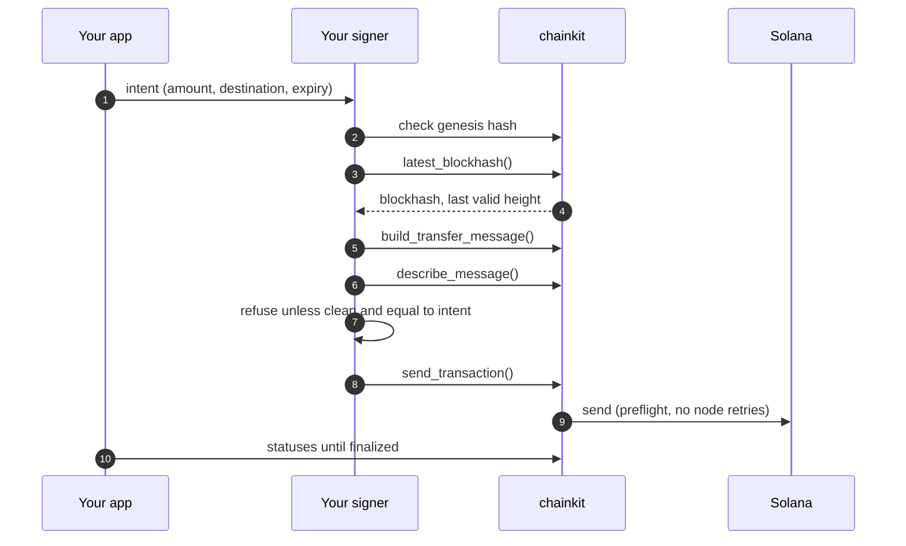

Re-sign only after the block height passes the last valid height and the old signature was never seen: that makes a
double payment impossible.

### Pricing a recipient's account creation

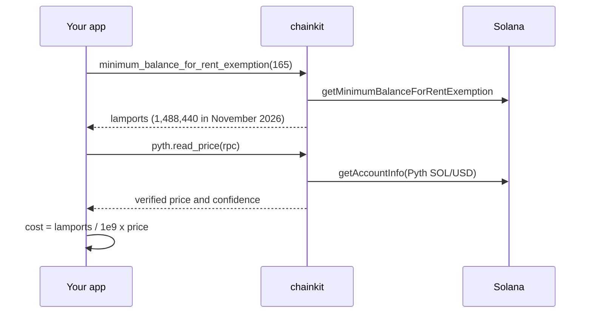

## Security model

| Threat | Mitigation in chainkit | Proven by |
|---|---|---|
| Fake token named "USDC" | Exact mint comparison and classic token program check on every balance row | `test_lookalike_mint_and_other_token_program_are_ignored` |
| Money rounding errors | Integer atomic units; floats and ambiguous inputs refused | `test_amounts.py` including property tests over the full u64 range |
| Homoglyph digits ("١٢٣") | ASCII-only amount pattern | `test_invalid_strings` |
| Hidden instruction in a transaction to sign | `describe_message` reports every unrecognised instruction | `test_describe_flags_everything_it_does_not_recognise` |
| Extra signer smuggled into a transfer | Exact account count required for `transferChecked` | `test_describe_rejects_transfer_checked_with_extra_signer_accounts` |
| Signing against the wrong cluster | Genesis hash constants and `cluster_for_genesis` | live tests |
| Double payment on retry | `lastValidBlockHeight` exposed; node-side retries disabled | design (documented flow) |
| Missed deposits during an outage or burst | Complete paging that raises instead of truncating; failover across providers | `test_paging_beyond_the_limit_raises_instead_of_truncating` |
| Manipulated or stale price | On-chain Pyth account with owner, verification, feed, age and confidence checks | `test_untrustworthy_accounts_are_refused` |
| Typos in hard-coded addresses | Weekly live tests against real clusters | `test_live.py` (caught a mainnet USDC mint typo) |
| Key exposure | chainkit never handles private keys | design |

## Verification and quality

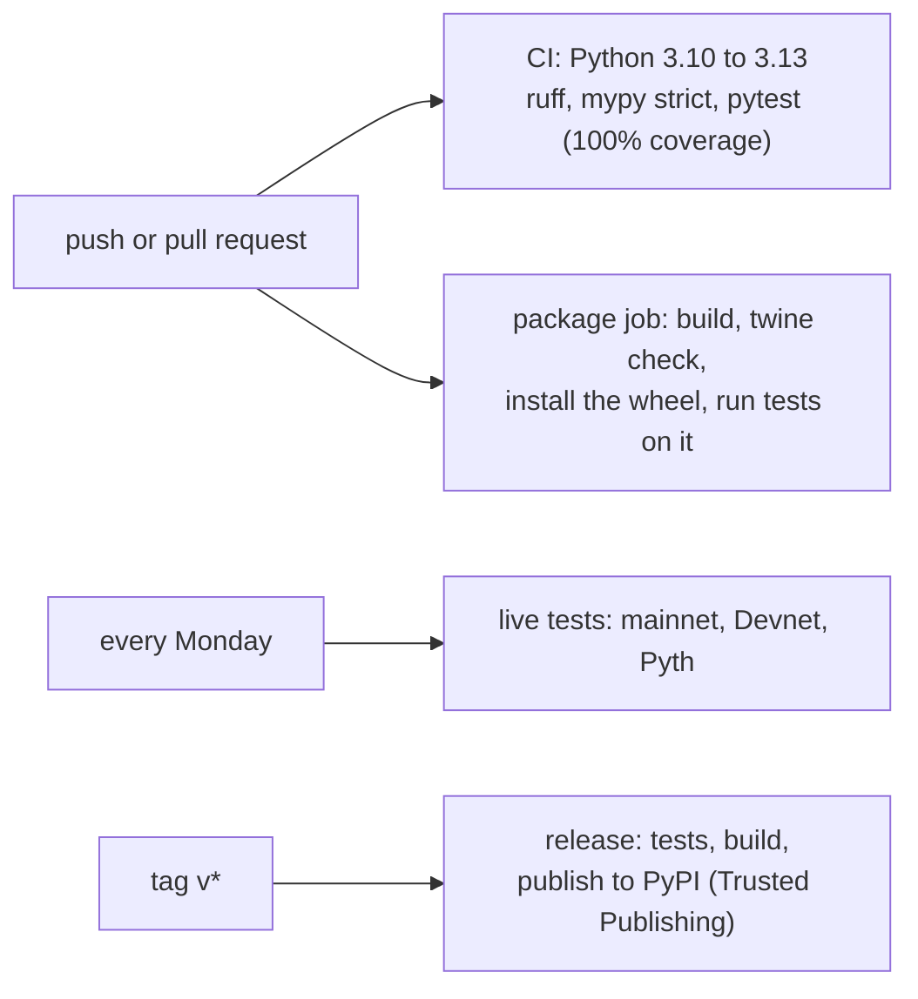

| Layer | What it checks |
|---|---|
| Unit tests (125) | Every module, every rejection path, every branch (100% line and branch coverage) |
| Property tests | Amount round-trips over 1 to `U64_MAX`; Decimal and string inputs agree |
| Live tests (14) | Genesis hashes, USDC mints (owner, decimals, supply), every program id is an executable program, ATA derivation against a real account, rent, Pyth price, version-0 index assumption |
| Static checks | ruff (including security rules), mypy strict |
| Packaging | The built wheel is installed in a clean environment and the tests run against it |

Live tests found two real problems before release: a one-letter typo in a hard-coded mainnet USDC mint, and a change in
token-account rent from 2,039,280 to 1,488,440 lamports.

## Compatibility and versioning

- Semantic versioning; the public API is everything documented here. Breaking changes before 1.0 are listed in the
  changelog.
- Legacy messages are built and described; version-0 transactions are read (`transaction`, `parse`).
- Classic SPL Token only, which is what USDC uses; Token-2022 is recognised in order to be rejected.
- Python 3.10 to 3.13; `solders` 0.21 or later (below 1.0), `requests` 2.31 or later (below 3).

## Limitations and non-goals

- Not a wallet, custody service or key manager; signing is the caller's responsibility.
- Does not persist state: callers store the last processed signature and their own ledger.
- `describe_message` covers legacy messages; signing version-0 messages needs an equivalent check.
- Price reading covers Pyth push-oracle accounts; other oracles are out of scope.

## Roadmap

| Version | Planned |
|---|---|
| 0.2 | Solana Pay: build and parse transfer requests, verify payments by `reference` key |
| 0.3 | Documentation site, more examples (payroll batches, reconciliation) |
| 1.0 | Stable API after production use on mainnet |

## Glossary

| Term | Meaning |
|---|---|
| Atomic units | Smallest USDC unit; 1 USDC = 1,000,000 |
| ATA | Associated token account: the standard USDC account of a wallet |
| Mint | The token's on-chain definition; USDC is identified by its mint address |
| Genesis hash | Unique identifier of a Solana cluster |
| Blockhash, last valid block height | A transaction is valid only until that height; afterwards it can never land |
| Rent | SOL an account must hold to exist; charged once when a token account is created |
| Pyth | A price oracle whose prices are written to Solana accounts and verified by Wormhole guardians |
| Finalized | Confirmed by a supermajority of the cluster and irreversible |
